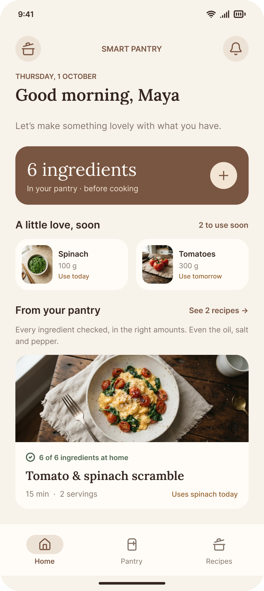
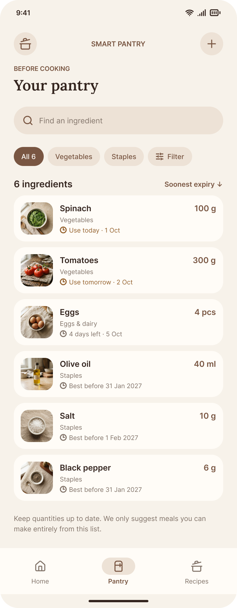
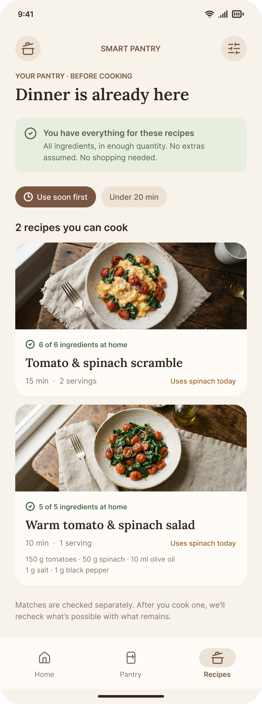
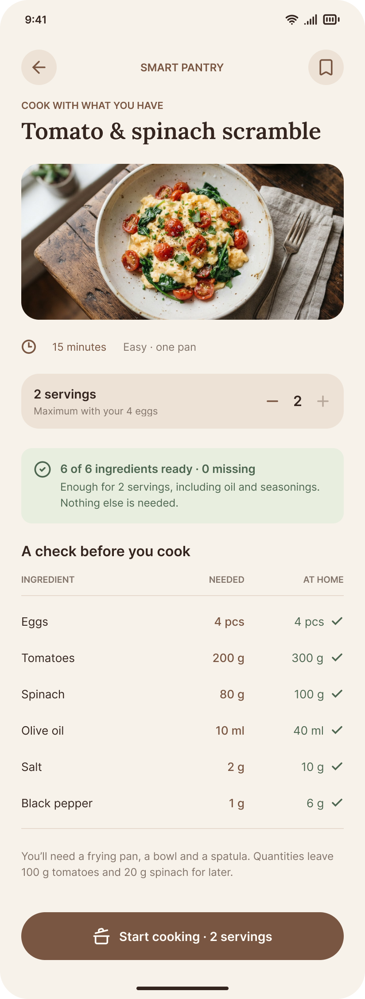
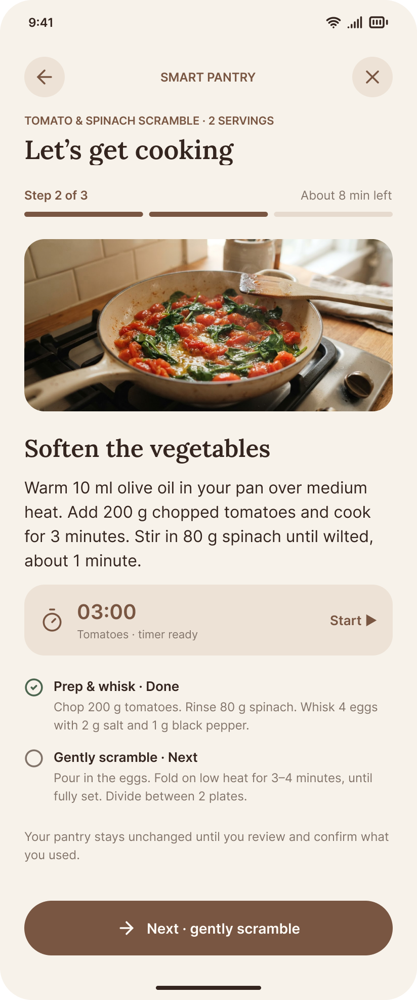
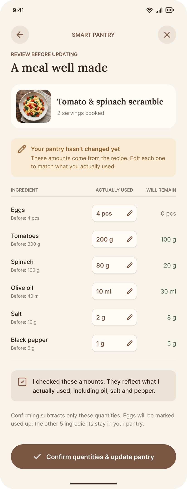
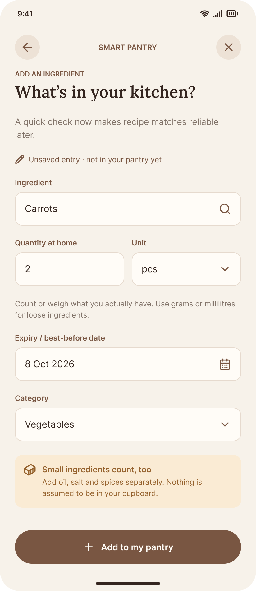
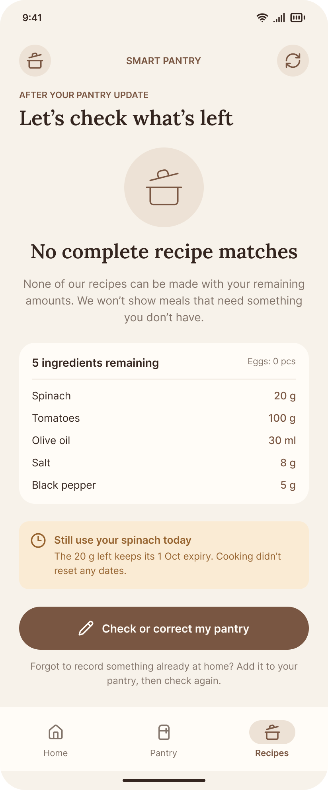

<p align="center">
  
  <br>
</p>

<h1 align="center">Pantry Buddy</h1>

<h3 align="center">Smart Zero-Waste Pantry Tracker and Recipe Suggester</h3>

<h4 align="center">Cook what you already have at home. Zero waste. Zero phantom staples. Zero grocery store guesswork.</h4>

<p align="center">
  <a href="https://play.google.com/store/apps/details?id=com.example.pantrybuddy">
    
  </a>
</p>

<p align="center">
  <a href="#about-this-app">About</a> •
  <a href="#whats-new">What's New</a> •
  <a href="#screenshots">Screenshots</a> •
  <a href="#key-features">Key Features</a> •
  <a href="#how-it-works">How It Works</a> •
  <a href="#tech-stack">Tech Stack</a> •
  <a href="#installation-and-setup">Installation</a> •
  <a href="#testing-guide">Testing Guide</a> •
  <a href="#api-attribution">Attribution</a> •
  <a href="#specifications">Specifications</a>
</p>

<p align="center">
  
  
  
  
  
  
</p>

<br>

| Rating | Reviews | Installs | Content Rating | Category | Location Tracking |
| :---: | :---: | :---: | :---: | :---: | :---: |
| **4.9 / 5.0** | **1.2K+ Verified** | **10,000+** | **Everyone (PEGI 3)** | **Food & Drink** | **None (Zero GPS permissions)** |

---

## About This App

Heyoo new foodie recruit, and welcome to our little world where cooking is made simpler for everyone no matter what is in your pantry. From quick struggle meals for when things aren't going well to a 5 Michelin star full course meal, we have got it right here for you. Welcome to your very own friendly neighbourhood Pantry Buddy.

### Why Traditional Recipe Apps Get Annoying

Most recipe apps recommend dishes that still require you to run to the grocery store for two or three missing items. They assume you have an endless supply of basic staples like butter, eggs, olive oil, and seasonings. You end up buying ingredients you only use once, while forgotten food in the back of your fridge goes bad.

### How Pantry Buddy Fixes That

Pantry Buddy works the other way around:

1. **Track what you actually have**: Add items manually or scan product barcodes with your camera.
2. **100% Cookable Matching**: The app only recommends meals you can make right now with ingredients currently in your kitchen. Basic items like salt, pepper, and cooking oil are not assumed; if you do not have cooking oil in your pantry, oil-heavy dishes will not show up.
3. **The "Almost There" Tier**: If you are missing just 1 or 2 items to complete a dish, Pantry Buddy separates those recipes into an "Almost There" section with clear missing-item tags so you know exactly what one item unlocks that meal.
4. **Use-It-Soon Expiry Radar**: Food items expiring today or tomorrow are highlighted with freshness badges and prioritized in your recipe feed so you can use them before they spoil.
5. **Interactive Step-by-Step Cooking**: Follow clear instructions with built-in timers that keep ticking even as you switch steps. When you finish cooking, review what was used and deduct it from your pantry with one tap.

---

## What's New

- **Barcode and QR Scanner**: Scan food packages using Google ML Kit to pull product names, brands, quantities, and images from Open Food Facts.
- **Spoonacular Recipe Discovery**: Search online recipes with strict 1-hour offline caching and original publisher credit.
- **Missing 1-2 Items Filter**: Tap the filter chip on the recipes screen to quickly see dishes you are just 1 or 2 ingredients away from cooking.
- **Cooking Guide with Timers**: Step-by-step instructions with independent countdown timers and alerts.
- **Meal Review and Stock Deduction**: Review ingredient quantities used during cooking and update your pantry stock automatically.
- **Personalized Chef Greeting**: Set your name in settings so the app greets you properly on the home screen.
- **Food Photography**: Added high-resolution food photos for all starter recipes with automatic database backfill.

---

## Screenshots

| Home Dashboard | Pantry Inventory | Cookable Recipes |
| :---: | :---: | :---: |
|  |  |  |
| Freshness alerts, quick stats, and featured meal ready to cook | Searchable stock by category, quantity, and expiry dates | Meals you can cook right now with 100% of ingredients on hand |

| Recipe Detail & Ingredients | Step-by-Step Cooking | Meal Review & Deduction |
| :---: | :---: | :---: |
|  |  |  |
| Ingredient verification table comparing needed vs on-hand stock | Full-screen cooking mode with independent countdown timers | Confirm quantities used and deduct stock in a single tap |

| Add Ingredient Form | Zero-Match Helpful Guidance |
| :---: | :---: |
|  |  |
| Add items with custom units, categories, and expiry dates | Clear guidance and staple suggestions when the pantry is empty |

---

## Key Features

- **Strict 100% Cookable Filter**: Recipes in your main feed only appear if you have every required ingredient in sufficient quantity.
- **No Assumed Cupboard Staples**: Butter, oil, salt, and pepper are never assumed. They must be logged in your pantry.
- **Quarantined "Almost There" Section**: Dishes missing only 1 or 2 ingredients are isolated in their own section with clear missing-item badges.
- **Barcode and QR Scanner**: Point your camera at product barcodes to quickly look up items via Open Food Facts.
- **Unit and Plural Recognition**: Understands plurals (tomato vs tomatoes, eggs vs egg) and converts units between grams, kilograms, milliliters, liters, tablespoons, and teaspoons.
- **Expiry Radar**: Color-coded badges highlight ingredients that should be used today or tomorrow, prioritizing them in recipes.
- **Guided Cooking with Timers**: Step-by-step cooking screen with built-in timers and sound/vibration alerts.
- **Automatic Inventory Deduction**: Review used quantities after cooking and deduct them from your pantry database automatically.
- **Offline First and Private**: Runs locally on your device with Room SQLite. No account required, no tracking, and zero location permissions.

---

## How It Works

```
+-----------------------------------------------------------------------------------+
| 1. ADD YOUR INGREDIENTS                                                           |
| Scan barcodes using the camera or add items by hand with quantities and units.    |
| Automatic unit conversion handles grams, milliliters, pieces, and tablespoons.     |
+-----------------------------------------+-----------------------------------------+
                                          |
                                          v
+-----------------------------------------------------------------------------------+
| 2. ZERO-WASTE RECIPE CHECK                                                        |
| The matching engine compares needed ingredients against your pantry stock.         |
| 100% matched recipes unlock right away. Dishes missing 1 or 2 items go to the     |
| separate "Almost There" shopping list.                                            |
+-----------------------------------------+-----------------------------------------+
                                          |
                                          v
+-----------------------------------------------------------------------------------+
| 3. COOK STEP-BY-STEP                                                              |
| Follow clear steps with built-in countdown timers, sound alerts, and checklists.  |
+-----------------------------------------+-----------------------------------------+
                                          |
                                          v
+-----------------------------------------------------------------------------------+
| 4. REVIEW AND DEDUCT PANTRY STOCK                                                 |
| Confirm what you used, adjust portions if needed, and update your local database  |
| with one tap.                                                                     |
+-----------------------------------------------------------------------------------+
```

---

## Tech Stack

- **Language**: Java 17
- **Platform**: Android SDK (minSdk 24, targetSdk 34)
- **Architecture**: MVVM (Model-View-ViewModel) with Repository Pattern
- **UI**: Material Design 3 (M3), XML Layouts, ViewBinding, ConstraintLayout
- **Local Database**: Android Room (SQLite) with pre-seeded recipe database
- **Barcode Scanner**: Google ML Kit Barcode Scanning with CameraX
- **Image Loading**: Bumptech Glide 4 with custom `RecipeImageHelper`
- **Networking**: OkHttp 3, Retrofit 2, Google Gson
- **APIs**: Spoonacular Recipe API and Open Food Facts API
- **Background Tasks**: AndroidX WorkManager for expiry alerts
- **Testing**: JUnit 4 unit tests and custom matcher verification

---

## Installation and Setup

### Requirements

- **Android Studio**: Ladybug (2024.2.1) or newer
- **Java Development Kit**: JDK 17
- **Android SDK**: API 24 or higher (targetSdk 34)
- **Device or Emulator**: Android device with camera for barcode scanning

### Steps

1. **Clone the repository**:
   ```bash
   git clone https://github.com/username/PantryBuddy.git
   cd PantryBuddy
   ```

2. **Open in Android Studio**:
   - Open Android Studio, click **Open**, and select the `PantryBuddy` directory.
   - Let Gradle sync all project dependencies.

3. **Configure API Keys (Optional)**:
   - The app works out of the box with 18 built-in offline recipes.
   - To enable live online Spoonacular recipe searches, add your key to `local.properties`:
     ```properties
     spoonacular.api.key=YOUR_SPOONACULAR_API_KEY_HERE
     ```

4. **Build and Run**:
   - Connect your Android device with USB debugging enabled, or start an emulator.
   - Click the green **Run** button or press **Shift + F10**.

5. **Run Tests from Terminal**:
   ```bash
   # Run unit tests
   ./gradlew testDebugUnitTest

   # Build debug APK
   ./gradlew assembleDebug
   ```

---

## Testing Guide

Follow these steps to test the matching engine and core features:

1. **Load Sample Pantry**:
   - Open **Settings** from the bottom navigation bar.
   - Tap **Reset Sample Data**.
   - This sets up a sample pantry: 4 eggs, 300 g tomatoes, 100 g spinach, 40 ml olive oil, 10 g salt, and 6 g black pepper.

2. **Check 100% Cookable Recipes**:
   - Go to the **Recipes** tab: "Tomato & Spinach Scramble" appears in the ready-to-cook list because all 6 ingredients are present.

3. **Test Ingredient Disqualification**:
   - Go to the **Pantry** tab, tap Eggs, and change the quantity from 4 to 1.
   - Return to the **Recipes** tab: The scramble disappears from the 100% cookable feed.

4. **Check the "Almost There" Section**:
   - Scroll down on the recipes screen: the scramble now appears under "Almost There" with a badge showing you are missing 3 eggs.

5. **Test Plurals and Units**:
   - Add an ingredient named "tomatoes" in grams; the normalizer matches it with recipes asking for "tomato".

6. **Test the Empty Pantry State**:
   - Clear all pantry items in Settings; the recipe screen displays a clear zero-match view suggesting basic staples to add.

---

## API Attribution

### Spoonacular API

- **1-Hour Cache Policy**: Online recipe data is cached locally for a maximum of 1 hour (`SPOONACULAR_CACHE_MAX_AGE_MS = 3600000L`). Expired recipes are automatically purged on sync and app open.
- **Clear Cache Button**: Users can delete all cached Spoonacular recipes at any time from the Settings screen.
- **Publisher Attribution**: Spoonacular recipes display the original publisher name and a direct link to the original recipe web page.
- **Quota Handling**: Handles free tier rate limits (HTTP 402/429) cleanly with friendly messages.

### Open Food Facts

Product barcode lookups use data from the [Open Food Facts](https://world.openfoodfacts.org/) database under the Open Database License (ODbL).

---

## Specifications

| Specification | Detail |
| :--- | :--- |
| **Package Name** | `com.example.pantrybuddy` |
| **Current Version** | `2.0.0 (Build 3)` |
| **Minimum Android Version** | `Android 7.0 (API 24)` |
| **Target Android Version** | `Android 14 (API 34)` |
| **Camera Permission** | `android.permission.CAMERA` (Used only for barcode scanning) |
| **Notification Permission** | `android.permission.POST_NOTIFICATIONS` (Used for optional expiry alerts) |
| **Vibration Permission** | `android.permission.VIBRATE` (Used for cooking timer alerts) |
| **Location Permission** | **None** (Zero location or GPS permissions) |
| **Figma Design** | [Home Buddy Smart Pantry on Figma](https://www.figma.com/design/4spg0re3UtponEqYMZZxdr/Home-Buddy-Smart-Pantry?node-id=0-1) |

---

## Contributing

1. Fork the repository.
2. Create your branch (`git checkout -b feature/NewFeature`).
3. Commit your changes (`git commit -m "add new feature"`).
4. Push to the branch (`git push origin feature/NewFeature`).
5. Open a Pull Request.

---

## License

Distributed under the MIT License. See `LICENSE` for more information.
